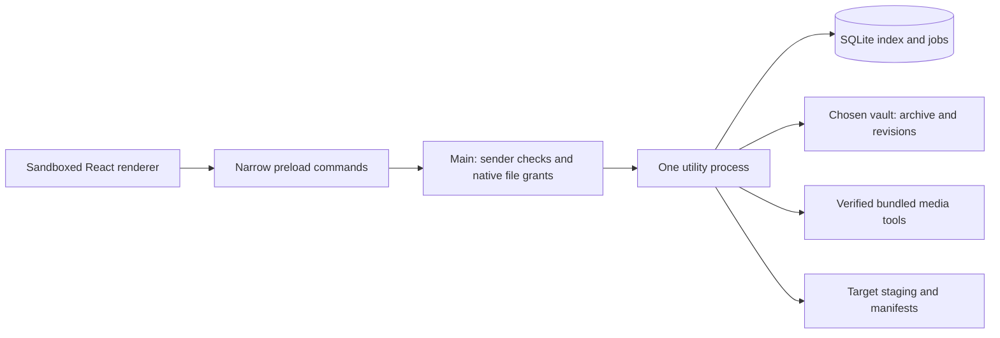

# Architecture and data

TuneVault is an Electron/TypeScript desktop app with a React renderer.

Renderer Node integration is off, context isolation and sandboxing are on.
Main validates sender/frame, action names and native-picker/drop path grants.
The worker owns SQLite and media jobs. Source descriptions render as text;
remote executable content is not loaded. Tools run with argument arrays and
shell disabled; installed operation must not depend on PATH.

SQLite stores stable IDs, track metadata/locks/origins/revisions, repeated
ordered playlist occurrences, source snapshots, queue jobs, target profiles and
per-target receipt history. Audio remains in ordinary vault files. A metadata
edit produces a recoverable managed revision, preserving the original. Missing
media does not remove playlist history; relink checks exact content evidence.

Schema 2 uses numbered transactional migrations, a verified pre-migration
SQLite backup, and an integrity check before changing an existing database.
Moving a vault requires choosing its new location and verifying all recorded
media/revision hashes before paths are rewritten together. A mismatch leaves
the existing index and settings intact.

An export target is separate from its transport and format profile. A revision
change makes affected target receipts stale. Repeated entries remain separate
occurrences. A complete source refresh is reviewed before applying; source
removal changes membership and never deletes archived audio.

Vault revisions and derived target renditions are retained for recovery.
Review disk use and keep a full-media backup; metadata-only backups do not
contain audio. No cloud database, account system or hosted backend is involved.
