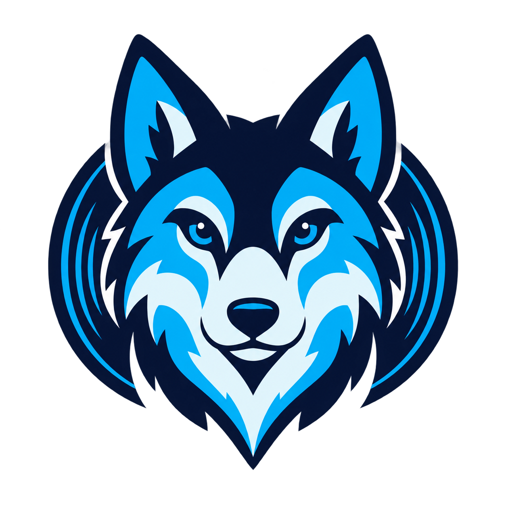

# TuneVault wolf logo concept

Created 2026-10-28 with the built-in imagegen tool. This is an AI-generated concept, not a trademark clearance or a finished vector identity.



The image is a transparent 1254 x 1254 PNG. Navy `#091533`, cyan `#00ACED`, and ice highlights connect a friendly blue wolf with record/vault rings. Use a separate text wordmark, **TuneVault**, so the app name stays crisp and accessible.

The full-size concept has more facial detail than a tiny toolbar symbol needs. Inspect at 16/32/64 px before a release; simplify to an editable vector master for a final icon rather than claiming this raster is a scalable production logo. Package real `.icns` and multi-size `.ico` assets later. Keep original provenance intact and disclose generation honestly. No logo/trademark search was performed.

## Exact generation prompt

```text
Use case: logo-brand. Create a polished original wolf-themed logo symbol for TuneVault, a personal music archive and portable-player desktop app. Single centered symbol ONLY, no text, no letters, no presentation board, no surrounding mockup. A calm clever blue wolf face formed from bold simple geometric silhouettes, with a single understated record groove / circular vault-ring shape integrated behind the cheeks. Friendly and capable, not an esports mascot, not snarling, no fangs. Early 2000s hi-fi hardware restraint, modern small-size readability. Flat vector-like art, 2-3 solid colors: deep navy #091533, cyan #00ACED, small pale ice-blue highlight. Symmetric overall shape with tall clear ears and distinct wolf muzzle. Crisp solid contours, generous negative space, recognisable at 32 pixels, no tiny fur strokes, no gradient, no glow, no metallic texture, no drop shadow, no border. Transparent background outside the symbol. Keep generous transparent padding. This is an AI-generated brand concept; retain provenance metadata. Output one high-resolution square transparent image.
```
