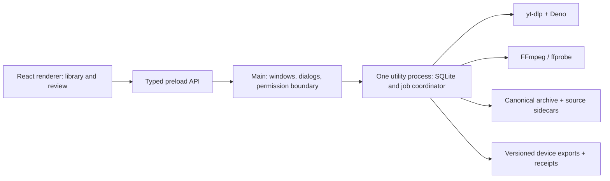

# TuneVault desktop architecture research

Researched: 2026-10-28. Scope: a new TuneVault implementation in its own repository, with public macOS and Windows installers from the first release. Nathanial subsequently specified no OS code signing and requested strong E2E CI/CD plus updates; that decision governs the release plan below. This document recommends an architecture; it does not claim an application or installer has been built.

## Decision

Use **Electron + TypeScript + React + electron-vite + electron-builder**, with **SQLite in one background utility process** and **yt-dlp, FFmpeg/ffprobe, and Deno as pinned per-platform executable dependencies**. Keep the application local, with no account, server, cloud library, Docker, or subscription.

This preserves the existing TuneVault technology direction while fixing its incomplete cross-platform binary story. The main advantage is maintainability for this owner: one TypeScript application and one UI engine, with mature access to filesystem operations and background processes. This is an engineering recommendation, not a measured claim that Electron is faster or smaller than another framework.

| Candidate | Verified capability / cost | TuneVault decision |
| --- | --- | --- |
| Electron | Bundles Chromium and Node; supports macOS and Windows. UI, privileged code, and jobs can share TypeScript. Runtime security updates become app maintenance. | Strongest fit for the existing project and owner. |
| Tauri 2 | Uses WKWebView on macOS and WebView2 on Windows; supports external binary sidecars; adds Rust and system toolchains. | Strong runner-up if download size and idle memory become measured problems. No evidence yet justifies a framework switch. |
| Flutter desktop | Officially supports macOS and Windows desktop builds and platform plugins; requires a Dart UI rewrite. | Credible platform, little benefit for this web/TypeScript project. |
| Separate SwiftUI and Windows native apps | Excellent OS integration is possible, but two frontends and integrations need maintenance. | Too much implementation and test work for this utility. |

Capabilities: [Electron platform support](https://github.com/electron/electron#platform-support), [Tauri WebViews](https://v2.tauri.app/reference/webview-versions/), [Tauri prerequisites](https://v2.tauri.app/start/prerequisites/), [Tauri sidecars](https://v2.tauri.app/develop/sidecar/), [Flutter desktop](https://docs.flutter.dev/platform-integration/desktop). Comparative maintenance judgments are project-specific inferences.

Keep `electron-vite` and `electron-builder` rather than changing packaging tools just for the rebuild. The former documents main/preload/renderer builds and the latter integration. The Electron Forge Vite plugin remains marked experimental in its current documentation; adopting it adds a migration without solving a TuneVault requirement. Pin compatible versions in the lockfile. [electron-vite guide](https://electron-vite.org/guide/), [distribution guide](https://electron-vite.org/guide/distribution), [Forge Vite status](https://www.electronforge.io/config/plugins/vite).

## Version and platform policy

Use a supported stable Electron release when implementation starts; do not carry forward Electron 33 from the archived application. Electron supports its newest three stable major lines. Record the actual Electron, Chromium, embedded Node, yt-dlp, FFmpeg, ffprobe, and Deno versions in the build manifest and Diagnostics screen. The development shell's Node version does not establish the packaged runtime's capabilities. [Electron release policy](https://www.electronjs.org/docs/latest/tutorial/electron-timelines), [runtime process properties](https://www.electronjs.org/docs/latest/api/process).

The current upstream README lists macOS Ventura and later, Intel and Apple Silicon, and Windows 10 and later, x64 and ARM64. These are framework capabilities, not a tested TuneVault support statement. Recommend first-release targets **macOS arm64 and x64**, plus **Windows x64**. Windows ARM64 is a separate artifact only after every bundled executable has a native compatible build and the full workflow passes. Set the minimum OS after selecting the actual stable runtime and binary set. A 6th-generation iPod touch is an export destination; TuneVault does not need to run on its iOS version. [Electron platform support](https://github.com/electron/electron#platform-support).

Use npm initially because that is the inspected project convention and packaging tooling documents it. Bun can be a development package-manager choice after verification, but must not be assumed to replace Electron's Node runtime or the yt-dlp challenge runtime.

## Small process model

Electron's utility process provides a Node child environment and message ports. Use one worker to own the database connection and queue, isolating synchronous SQLite and heavier metadata work from window interaction. The main process stays small. Do not introduce a localhost HTTP server, Express, tRPC, a separate always-running daemon, or one worker per song. [Electron utility process](https://www.electronjs.org/docs/latest/api/utility-process).

Define a short set of typed operations, for example `inspectImport`, `startImport`, `queryLibrary`, `saveMetadata`, `refreshPlaylist`, `previewExport`, `startExport`, `cancelJob`, and `acknowledgeTransfer`. These are proposed domain operations, not a new general RPC framework. Validate arguments on the privileged side; TypeScript alone does not validate IPC data. Return structured results and bounded progress events. Never expose raw `ipcRenderer`, arbitrary filesystem access, executable names, command strings, or SQL to the renderer.

## Storage and crash recovery

Recommend built-in **`node:sqlite`**, using only the API verified in the chosen Electron runtime. Node 24 documentation currently labels it release-candidate stability and provides `DatabaseSync`, prepared statements, and a backup operation. Newer Node documentation changes names, so use version-matched documentation and pin the Electron runtime. Before UI implementation, prove opening a database, a parameterized insert, a transaction, a backup, and reopen in a packaged utility process on each supported OS. If the pinned runtime cannot pass this spike, document that concrete failure before choosing `better-sqlite3`; do not silently substitute an in-memory or JSON database. [Node 24 SQLite](https://nodejs.org/docs/latest-v24.x/api/sqlite.html).

Use explicit schema migrations in transactions with a schema version and pre-migration backup. Enable foreign keys. One writer avoids application-level races. Store library rows, playlist occurrences, source snapshots, jobs, export profiles, and transfer receipts in SQLite; store audio and artwork as ordinary portable files. Do not store huge media blobs in SQLite.

Proposed locations:

| Data | Location / ownership |
| --- | --- |
| Database and small settings | An application-owned subfolder of `app.getPath('userData')` |
| Canonical downloaded/imported audio | User-chosen TuneVault library root; one archive copy |
| Source metadata and descriptions | Archive sidecars associated with source and snapshot |
| Device derivatives | Separate user-chosen export root or explicitly selected USB folder |
| Temporary jobs | Per-job staging directory; never masquerading as final output |
| Logs | Application logs with URL/token/path redaction and a bounded retention policy |

Electron advises against putting large files in `userData` because some environments back it up or roam it. Choose media storage explicitly. [Electron app paths](https://www.electronjs.org/docs/latest/api/app#appgetpathname).

Use atomic staging/finalization: write a temporary output beside the intended final file, verify the file and tags, then rename it and commit the completed asset record. A restart reconciles interrupted job rows with staging files. Never mark a song downloaded merely because its process started or exited without validating the resulting asset. Missing removable volumes remain missing rather than causing implicit relocation or deletion. Keep originals untouched when importing existing files unless the user explicitly chooses a managed copy.

Back up the live database through SQLite's backup mechanism or a controlled closed-connection snapshot, rather than casually copying a live database and forgetting its WAL files. Back up sidecar/media manifests separately; a database backup is not an audio backup. Add library export/import for portability, preserving stable IDs and relative paths. [SQLite backup design](https://www.sqlite.org/backup.html).

## Executable dependency bundle

Use **official self-contained yt-dlp builds** for end users, **FFmpeg and ffprobe** for processing/inspection, and **Deno** for current YouTube challenge handling. Users should not need Homebrew, Python, Node, FFmpeg, or terminal commands to perform the core workflow. Development builds may locate existing tools through explicit configuration; production defaults must use the validated bundle.

Current yt-dlp requires external JS challenge scripts and a supported JS runtime for full YouTube support. Official bundled executables include the scripts; Deno is the recommended runtime and runs challenge code with restricted permissions. Pass its exact binary path rather than trusting GUI-process `PATH`. Do not use Electron's executable as an undocumented Node substitute. Bun support for this specific purpose is deprecated, even if Bun remains useful for project development. [yt-dlp EJS guide](https://github.com/yt-dlp/yt-dlp/wiki/EJS).

Bundle files outside `app.asar`, resolve from `process.resourcesPath`, preserve executable permissions, and include only binaries for that artifact's architecture. A macOS universal app does not automatically make third-party sidecars universal. Prefer separate macOS arm64 and x64 installers initially; this is easier to validate than a mixed universal bundle. ASAR has execution limitations. [electron-vite distribution](https://electron-vite.org/guide/distribution), [Electron resources path](https://www.electronjs.org/docs/latest/api/process#processresourcespath-readonly), [ASAR limitations](https://www.electronjs.org/docs/latest/tutorial/asar-archives).

Maintain a checked-in dependency manifest containing component, version, platform/architecture, upstream release URL, expected digest, license, source reference, and build flags where applicable. Fetch during a controlled build step, verify before executing, and fail a release build when an artifact is missing. yt-dlp publishes signed digest files; verification should use an independently trusted pinned release key, not a key fetched unchecked beside the download. [yt-dlp release verification](https://github.com/yt-dlp/yt-dlp#release-files).

For processing, invoke the real CLI directly with an argument array and `shell: false`; avoid an extra downloader or FFmpeg wrapper library. Use fixed supported options, structured yt-dlp output, and separate stdout/stderr handling. Stream progress; do not retain unlimited output. Bound metadata size, artwork dimensions, network timeouts, retries, and concurrent jobs. Keep one or two active download jobs initially, with bounded conversion concurrency. Exact concurrency is a tunable implementation decision, not a performance claim.

Cancellation must terminate the child and descendants on Windows as well as macOS, leave a consistent interrupted state, and preserve any resumable staging files under the job's ownership. Verify the actual process-tree strategy per OS; `child.kill()` alone is not proof that FFmpeg or another descendant ended.

## Security boundaries

Enable renderer sandboxing and context isolation; disable renderer Node integration. Use a restrictive CSP, local app UI, navigation/window-open denial by default, and a small validated preload API. Keep Electron patched. These follow the official security guidance. [Electron security](https://www.electronjs.org/docs/latest/tutorial/security).

TuneVault-specific requirements inferred from its trust boundaries:

- Treat video titles, descriptions, tags, filenames, playlists, and artwork as untrusted input. Render text as text, never as HTML. Do not inject descriptions into shell commands.
- Accept supported provider URLs through a parser and host allowlist. Separate YouTube media import from Spotify/Apple metadata import and local file import. Reject local-file URLs, unexpected protocols, and arbitrary executable arguments.
- Run yt-dlp with ignored ambient configuration and disabled plugin discovery. User-owned system configs must not unexpectedly execute commands or alter destinations. Do not expose freeform advanced CLI flags in the first release.
- Keep all generated paths beneath the user-selected output root after normalization and real-path checks. Handle Windows reserved names, Unicode, case-insensitive collisions, long paths, and symlink escapes. Never use a remote title as an unchecked path segment.
- Process downloaded media locally; do not allow metadata to make FFmpeg fetch a second arbitrary network URL. Enforce temporary-file and disk-space ownership.
- Use OS credential storage for OAuth secrets if integrations are added. Never embed a reusable confidential client secret in a desktop executable. Do not log cookies or tokens. No browser-cookie extraction by default.
- Use a constrained local media protocol or equivalent safe asset resolver; avoid granting arbitrary `file://` access for previews. Reject renderer requests for paths outside authorized media/artwork roots.
- Ask separately before any destructive mirror/prune operation. Default exports are additive, and receipts identify TuneVault-owned files only.

These requirements should be verified with malicious fixture values and real filesystem tests, not checked off because Electron security flags exist.

## Public distribution and licensing

The yt-dlp **source** is Unlicense, but official PyInstaller executables contain other components and are licensed GPLv3+. Do not label the bundled binary simply Unlicense. Preserve the exact executable's notices and corresponding-source obligations. The app's own license must be recovered from the existing repository/history and preserved unless Nathanial explicitly changes it. A CLI process boundary does not remove redistribution duties for the CLI; it also does not by itself establish that the entire application must use the CLI's license. [yt-dlp licensing](https://github.com/yt-dlp/yt-dlp#licensing).

FFmpeg is LGPL by default, while enabled optional GPL components change the build's license. Avoid nonredistributable `--enable-nonfree` builds. Record the actual shipped build configuration, source, patches, notices, and obligations; the installed Homebrew binary is not a ready-made release supply chain. Prefer a minimal reproducible LGPL build supporting the formats TuneVault needs if that satisfies the release profile. Calling FFmpeg as a subprocess does not make its binary obligations disappear. [FFmpeg legal and build checklist](https://ffmpeg.org/legal.html).

Ship `THIRD_PARTY_NOTICES` plus accessible About/Dependencies details and the required corresponding-source material or compliant offer/links for the actual shipped artifacts. Include Deno, Electron/Chromium, and bundled third-party licenses in the dependency audit. Do not copy an application's MIT badge onto every component. This is a release engineering requirement; exact license compliance must be checked against the selected binary distributions before publication.

Use **electron-builder** to prepare macOS DMG artifacts and a Windows NSIS installer. Build each OS on its own runner, with platform-specific signing configuration. Recheck builder's current schema rather than copying the archived v25 configuration: the main docs describe unreleased v27, whose settings differ from current stable v26. Use the chosen stable version's docs. [electron-builder macOS](https://www.electron.build/docs/mac/), [v27 configuration changes](https://www.electron.build/docs/migration/v27-config-changes/).

Unsigned public installers are the accepted release policy. Use Windows NSIS with authenticated update downloads and an explicit restart/install action; on macOS use verified automatic checks/downloads plus manual DMG replacement because the normal updater requires code signing. A free Ed25519 update-verification key is approved; it does not sign the OS application. See [release testing research](release-testing-research.md) for stable-version constraints, the update trust protocol, owner key setup, CI matrix, installer-to-upgrade testing, and OS warning guidance.

## Required proof before calling the rebuild complete

1. **Dependency spike:** packaged worker opens SQLite, runs each bundled executable, reports versions, processes a generated fixture, and finds tools with a clean `PATH` on macOS and Windows.
2. **Core tests:** playlist occurrence/order reconciliation, metadata precedence/manual locks, source identity, stale-export detection, filename confinement, collision handling, transfer receipt transitions, cancellation, and restart recovery.
3. **Media round trips:** generate fixtures locally with FFmpeg; export MP3, AAC/M4A, FLAC, ALAC and WAV as supported; inspect codec/container, duration, tags and attached artwork with an independent reader or ffprobe. Never infer losslessness from extension.
4. **Filesystem failures:** read-only target, unplugged USB, insufficient space, locked file, changed destination volume, Unicode/reserved names, title collisions, interrupted export, and missing original.
5. **UI verification:** desktop and narrow desktop sizes, keyboard paths, focus, screen reader labels, reduced motion, empty/error/offline states, 10,000-row fixture responsiveness, and real packaged file drops.
6. **OS artifacts:** unsigned macOS arm64/x64 downloads and unsigned Windows x64 installation, launch, conversion, uninstall-with-data-retained, and application upgrade without library loss.
7. **Hardware:** actual iPod touch 6th-generation and at least one named generic player. Export preparation, iMazing import, on-device metadata/artwork/order/playback are separate evidence levels.

Automated integration tests should use deterministic local media and fake provider fixtures. Make live extraction tests opt-in with an authorized sample URL. A successful live request today is not an offline test fixture or a promise of permanent provider access.

## What remains unverified

No new Electron dependency set, packaged SQLite binding, unsigned installer, updater, sidecar bundle, media conversion, or physical player transfer has been tested in this research task. The architecture's size, memory use, and library performance are estimates until measured. API access and exact player compatibility remain separate research/implementation gates. No claim of universal macOS/Windows/device support is justified by a framework's platform list.
