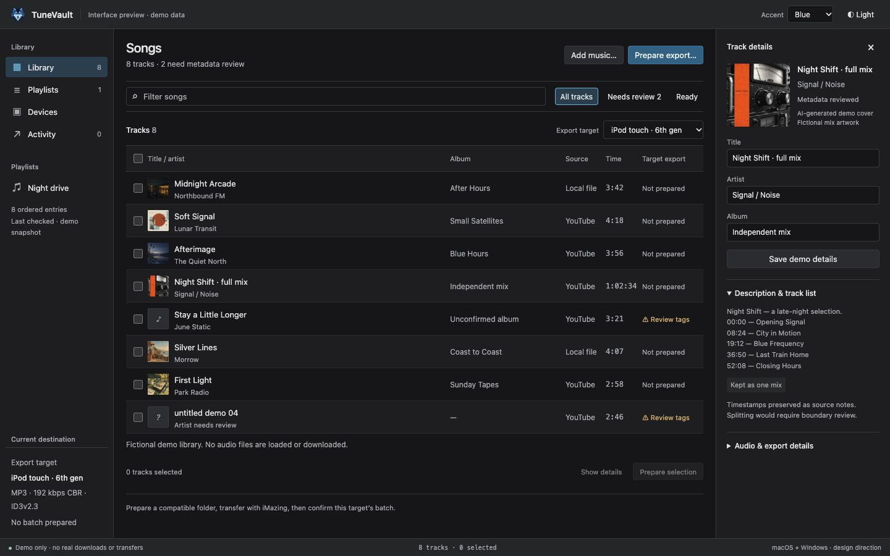
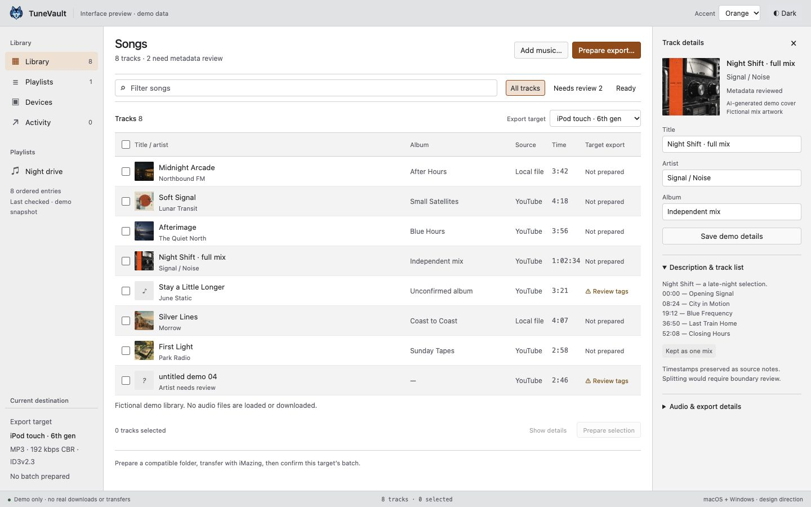
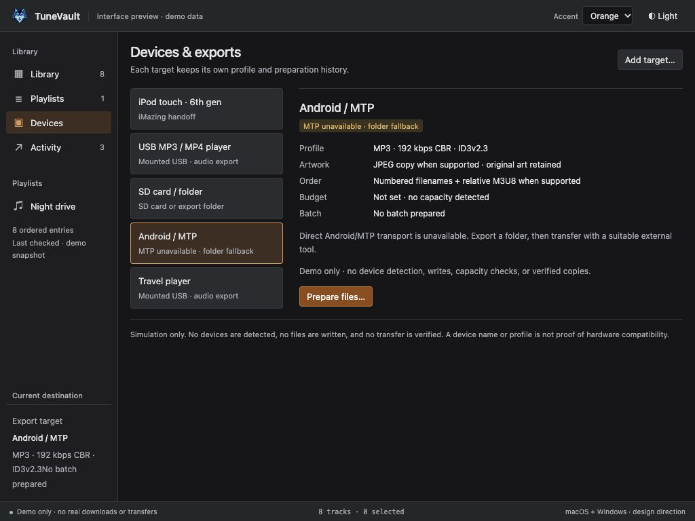
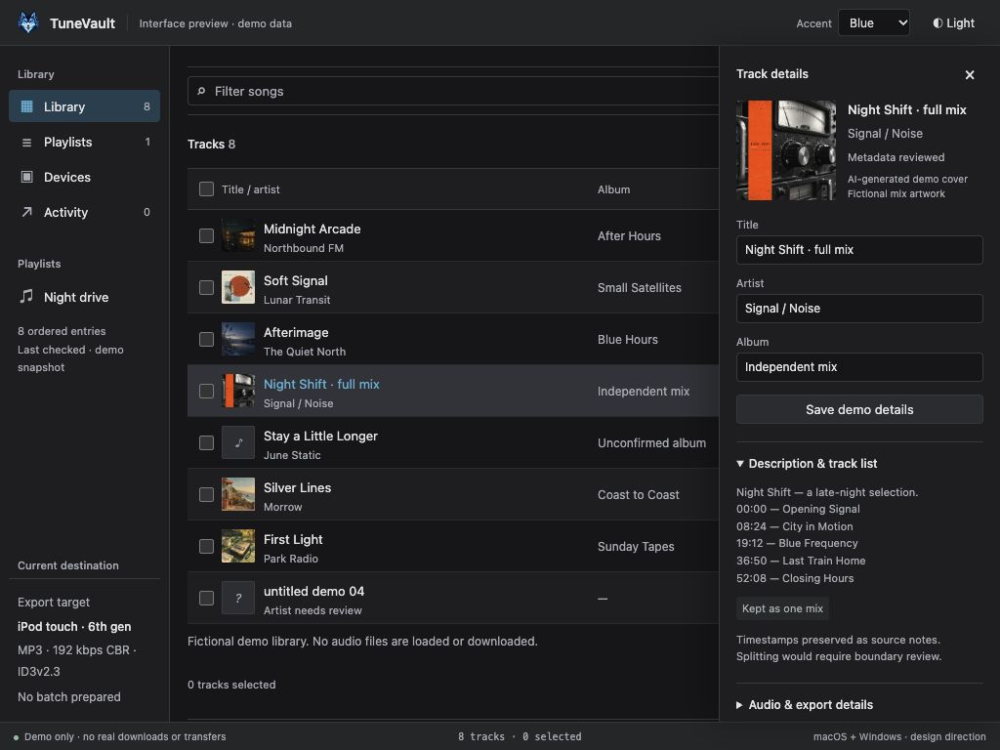

# TuneVault visual handoff

Updated 2026-10-29. These are screenshots of the local HTML design simulation, not a built Electron application or evidence of downloaded audio/device transfer.

Open [the interactive preview](interface-preview.html) through the localhost server. The header's **Accent** control selects Blue or Orange; the adjacent button switches light/dark. The production app must add persisted Appearance System/Light/Dark and independent accent settings, as specified in the rebuild prompt.

## Library with actual fictional cover images

The library uses six [fictional generated covers](demo-artwork.md), two intentional missing-art states, an optional metadata inspector and target-specific export status. Small album art is actual PNG content, not a CSS-gradient substitute. In normal app mode a user's library must begin empty; these fixtures belong in opt-in demo/design/testing mode.

## Orange accent in light appearance

The accent changes selection, focus and actions while leaving album artwork and neutral surfaces alone. All four appearance/accent combinations have saved screenshots and 36 source-token text/hover contrast checks. That does not establish a complete accessibility audit.

## Multiple export targets

Try **Devices → Add target**. Name a player, select iMazing/USB/SD-folder/Android transfer route, then choose its baseline profile and optional budget. The preview's custom “Travel player” is fictional. Selecting Android explicitly explains that direct MTP is unavailable and offers the folder-handoff route. A declared budget is not detected free space.

In Library, switch the **Export target** selector. Prepare a demo batch for iPod, acknowledge the simulated handoff and confirm it; switch to USB and its rows remain Not prepared. Switching back preserves the iPod's history. No files are written, no actual device is detected, and no transfer is verified.

## Narrow desktop inspector

At narrower desktop width the details become a dismissible sheet. The table remains usable when it is closed. The mix keeps its description/timestamps and original cover; technical details stay behind a disclosure.

## Rebuild handoff requirements

- Copy the real demo-cover assets and manifest, with provenance, when available; use the screenshots to understand density, artwork and theme states rather than as a static screen to paste into the app.
- Build the missing production behavior: persistence, proper menus/dialogs, real metadata/acquisition jobs, native target selection, measured export plans and target receipts. HTML simulation is not an implementation shortcut.
- Adapt [inspected desktop patterns](desktop-reference-study.md) and [device workflows](device-workflow-comparison.md) into original TuneVault controls/branding. Do not copy competitor art/screens into the shipped app.
- Nathanial confirmed portable MP4 players mean audio-library targets; no video downloading/conversion is requested.
- Final app still needs keyboard, zoom, VoiceOver/NVDA, native dialog and physical-player tests. See [validation record](validation-record.md) for actual evidence.
